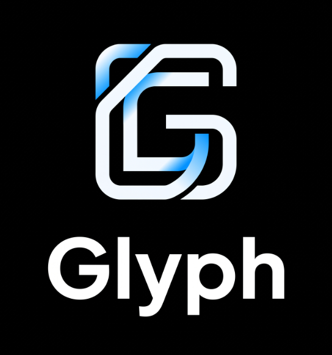

# Glyph ⚡ (v2.5)
> **Ultra-Minimal, Ephemeral ATS Vector Analyzer, Parser X-Ray & Live Resume Studio**



Glyph bridges the gap between candidate resumes and enterprise Applicant Tracking Systems (Workday, Greenhouse, Lever). It evaluates PDF and scanned image resumes strictly in **volatile RAM (`io.BytesIO`)**—combining **Role Ontology Expansion**, **Bidirectional Synonym Equivalence**, **TF-IDF Cosine Similarity**, **Google-XYZ Bullet Quantification Analysis**, and a **Split-Screen Live PDF Resume Compiler** with **zero data retention**.

---

## 💡 Why I Built Glyph (My Personal Experience)

I built **Glyph** out of my own personal frustration while applying for internships and software roles and trying to test my resume online:

1. **Every "Good" Tool Was Locked Behind Paywalls:** Almost every online ATS resume checker I tried locked the actual helpful feedback—like missing keywords, parser formatting issues, and resume re-scoring—behind `$29–$49/month` subscriptions at the exact time when students and job seekers shouldn't be forced to pay just to apply for jobs.
2. **"Free" Tools Were Crippled or One-Time-Use Only:** The tools that claimed to be free either blurred out the missing skills, stripped away essential features, or put me on a strict timer where I could **only scan my resume once within a time window** unless I upgraded or created multiple accounts.
3. **Zero Privacy & Sketchy Data Harvesting:** A resume has your most personal details on it—your full name, personal phone number, email, location, education, and work history. It frustrated me that online resume scanners quietly upload, store, and harvest user resumes on their servers to train models or sell candidate data to third parties.

I wanted a tool that I—and anyone else applying for jobs—could actually trust and use without limits. **Glyph** is **100% free**, has **zero scan limits or time-window locks**, **never asks for an account**, expands short role queries using online and industry role benchmarks, and processes every document (`PDF`, `PNG`, `JPG`) **strictly in volatile memory (`RAM`)** so your personal data is never saved or stolen.

---

## 🌟 Flagship Capabilities (v2.5)

- **🛡️ Multi-Format Resume vs. Non-Resume Classifier (PDF, PNG, JPG):** Strict line-level document authenticity gatekeeper verifies that uploaded files across **all supported formats** are genuine Resumes/CVs (requiring standalone section headers, candidate contact signals, and core resume pillars) while automatically rejecting **lecture notes, course slides, study guides, textbooks, homework/exams, syllabi, invoices, research papers, and random images/PDFs** immediately upon upload.
- **🧠 Role Ontology & Short-Form Query Expansion:** Accepts full job descriptions *or* short comma-separated role queries and shorthands (e.g., `Frontend, Backend Internships, SWE, MLE, K8s`). Automatically expands 18+ engineering, data, product, design, and security role profiles into canonical skill benchmarks with optional live web knowledge enrichment.
- **🔄 Bidirectional Acronym & Synonym Equivalence:** Recognizes short-form and full-form technical tokens interchangeably (`JS` ↔ `JavaScript`, `TS` ↔ `TypeScript`, `K8s` ↔ `Kubernetes`, `Postgres` ↔ `PostgreSQL`, `OOP` ↔ `Object-Oriented Programming`, `DSA` ↔ `Data Structures`, `AWS` ↔ `Amazon Web Services`).
- **🔬 Structural ATS Parser Audit & "X-Ray" Stream:** Audits contact header parseability, section hierarchy compliance, chronological tokens, profile links, and lexical density—with a toggleable **Parser X-Ray Drawer** showing the exact raw text stream extracted from the document.
- **📈 Bullet Quantification & XYZ Formula Rewriter:** Measures the percentage of resume bullets containing hard impact metrics (`%`, `$`, latency, scale), flags passive phrasing, and generates tailored **Google-XYZ achievement bullets** for missing keywords.
- **📄 Auto-Populated Split-Screen Resume Studio & Live Re-Scorer:** Automatically parses the candidate's uploaded resume into a split-screen editor with a **live real-time single-column paper preview**, 1-click missing keyword injection, and a **1-Click "Re-Score Optimized Resume in RAM"** button that verifies the exact score jump (`e.g., 64% → 94%`).

---

## 🏗️ Project Structure

```text
Glyph/
├── backend/
│   ├── main.py              # FastAPI ephemeral ATS engine, classifier, X-Ray & PDF compiler
│   └── requirements.txt     # Python backend dependencies
├── frontend/
│   ├── assets/
│   │   ├── readme.png       # UI preview showcase
│   │   └── Glyph_Logo.jpg   # Brand emblem
│   └── index.html           # Obsidian & Ice-Blue UI, telemetry dashboard & live studio
├── tests/
│   └── test_engine.py       # Test suite for classifier, ontology, synonyms & PDF compiler
├── LICENSE                  # MIT License
└── README.md                # Documentation & local setup instructions
```

---

## 🚀 Quick Start (Local Python)

1. **Install Dependencies:**
   ```bash
   pip install -r backend/requirements.txt
   ```
2. **Start the FastAPI Server:**
   ```bash
   python -m uvicorn backend.main:app --reload --host 127.0.0.1 --port 8000
   ```
3. **Open Glyph:**
   Navigate to **[http://127.0.0.1:8000](http://127.0.0.1:8000)**

---

## 🧪 Running Automated Tests

```bash
pytest tests/test_engine.py -v
```

---

## 📄 License
MIT License © 2026 Syed Haziq Zia Naqvi. Engineered with privacy and craftsmanship.
