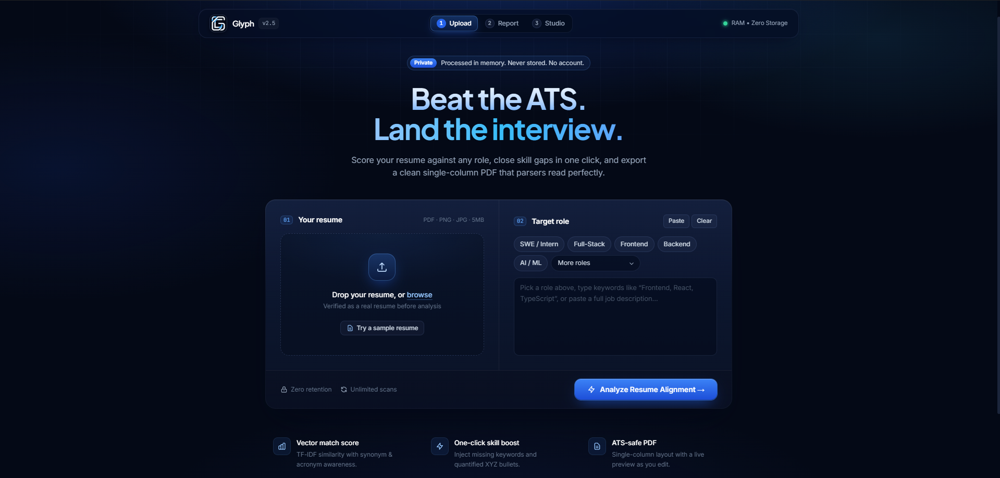
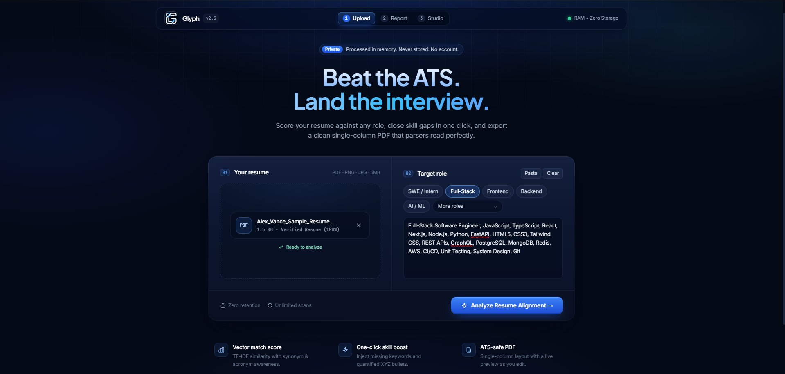
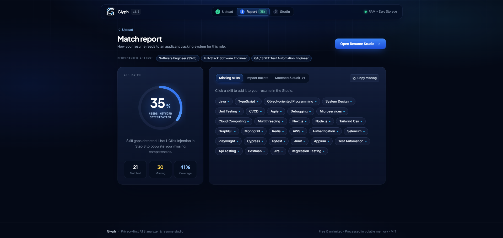
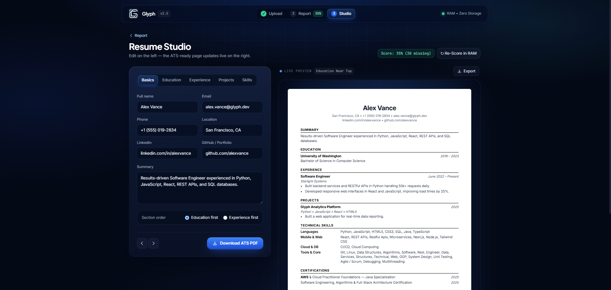

<p align="center">
  
</p>

<h1 align="center">Glyph — ATS Resume Studio</h1>

<p align="center">
  <strong>A privacy-first, in-memory ATS resume analyzer, parser X-ray audit, and single-column live resume studio with instant skill gap analysis and zero data retention.</strong>
</p>

<p align="center">
  <em>Built as an open-source, subscription-free alternative to commercial paywalled resume scanners.</em>
</p>

<p align="center">
  <a href="https://github.com/syedhaziqzia/Glyph-ATS"></a>
  <a href="https://github.com/syedhaziqzia/Glyph-ATS"></a>
  <a href="https://fastapi.tiangolo.com/"></a>
  <a href="https://www.python.org/"></a>
  <a href="https://tailwindcss.com/"></a>
  <a href="LICENSE"></a>
  
</p>

---

## 📸 Application Walkthrough & Workflow

### 1. Step 1 — Upload Resume & Target Role

#### Initial State (Upload Ready)
Upload any candidate resume (`PDF`, `PNG`, or `JPG`) or select one of the built-in role presets. The document gatekeeper verifies the file authenticity in RAM to reject non-resume files before processing.

<p align="center">
  
</p>

#### Loaded State (Sample Resume Ready for Analysis)
Candidates can load sample credentials or drop their own resume with an instantaneous verification signal and target role benchmark loaded.

<p align="center">
  
</p>

---

### 2. Step 2 — ATS Score & Skill Gap Telemetry
Inspect overall match percentage, skill coverage rates, and review missing competencies. Candidates can 1-click inject missing skills or append Google-XYZ quantified achievement bullets directly into the resume studio.

<p align="center">
  
</p>

---

### 3. Step 3 — Split-Screen Resume Studio & Real-Time PDF Compiler
Make real-time edits with immediate live single-column preview rendering, re-score the optimized resume in volatile RAM, and export an ATS-compliant PDF.

<p align="center">
  
</p>

---

## 💡 Why I Built Glyph (My Personal Experience)

I built **Glyph** out of my own frustration while applying for internships and software roles and testing my resume online:

1. **Every "Good" Tool Was Locked Behind Paywalls:** Almost every online ATS checker locked useful feedback—like missing keywords, formatting flags, and resume re-scoring—behind `$29–$49/month` subscriptions at the exact time when students and job seekers shouldn't be forced to pay just to apply for jobs.
2. **"Free" Tools Were Crippled or Had Strict Limits:** Tools claiming to be free either blurred out missing skills, removed key features, or put strict timers that allowed scanning only once unless you upgraded or made multiple accounts.
3. **Zero Privacy & Sketchy Data Harvesting:** A resume holds your personal information—your full name, phone number, email address, location, education, and work history. Many online scanners quietly upload, store, and harvest resumes to train models or sell candidate data to third parties.

I wanted a tool that anyone applying for jobs could genuinely trust and use without restrictions. **Glyph** is **100% free**, has **no scan limits or timers**, **requires no account**, expands short role titles using industry standards, and processes every document (`PDF`, `PNG`, `JPG`) **only in memory** so your personal data is never saved or shared.

---

## 🌟 What Glyph Does (v2.5)

- **🛡️ Real Resume vs. Non-Resume Checker (PDF, PNG, JPG):** Verifies that uploaded files are genuine resumes or CVs (checking for contact details, section titles, and typical resume structure) while automatically rejecting lecture notes, textbooks, homework, invoices, and research papers.
- **🧠 Smart Role Expansion:** Accepts full job descriptions or short role titles (such as `Frontend, Backend Internships, SWE, ML`). It automatically expands them into key skill benchmarks across software, data, product, design, and cybersecurity roles.
- **🔄 Acronym and Synonym Recognition:** Understands short and full technical terms interchangeably (e.g., `JS` ↔ `JavaScript`, `TS` ↔ `TypeScript`, `K8s` ↔ `Kubernetes`, `Postgres` ↔ `PostgreSQL`, `OOP` ↔ `Object-Oriented Programming`, `AWS` ↔ `Amazon Web Services`).
- **🔬 Parser Audit & X-Ray View:** Audits contact headers, section formatting, dates, and profile links. Includes an **X-Ray View** that reveals the exact raw text stream extracted from your document.
- **📈 Quantified Bullet Impact & XYZ Formula:** Checks what percentage of your resume bullets include concrete numbers and metrics (`%`, `$`, scale, latency), flags passive phrasing, and suggests tailored achievement bullets for missing skills.
- **📄 Split-Screen Resume Studio & Live Re-Scoring:** Automatically populates your uploaded resume into a clean split-screen editor with a live paper preview, 1-click missing skill injection, and a **"Re-Score in RAM"** button to verify your score improvement before exporting an ATS-ready PDF.

---

## 🏗️ Project Structure

```text
Glyph/
├── backend/
│   ├── main.py              # FastAPI ATS engine, parser audit & in-memory PDF builder
│   └── requirements.txt     # Python backend dependencies
├── frontend/
│   ├── assets/
│   │   ├── glyph_emblem.png                    # Transparent emblem logo
│   │   ├── Glyph_Logo.jpg                      # Brand artwork
│   │   ├── preview-step1-upload-empty.png      # Step 1: Upload Empty State
│   │   ├── preview-step1-upload-loaded.png     # Step 1: Upload Loaded State
│   │   ├── preview-step2-match-report.png      # Step 2: Match Report Telemetry
│   │   └── preview-step3-resume-studio.png     # Step 3: Live Resume Studio
│   └── index.html           # Deep navy interface, match report & live studio
├── tests/
│   └── test_engine.py       # Automated test suite (ontology, synonyms, PDF compiler)
├── LICENSE                  # MIT License
└── README.md                # Project documentation & local setup instructions
```

---

## 🚀 Quick Start (Run Locally)

1. **Install Dependencies:**
   ```bash
   pip install -r backend/requirements.txt
   ```
2. **Start the Server:**
   ```bash
   python -m uvicorn backend.main:app --reload --host 127.0.0.1 --port 8000
   ```
3. **Open Glyph:**
   Visit **[http://127.0.0.1:8000](http://127.0.0.1:8000)** in your browser.

---

## 🧪 Running Automated Tests

Run the test suite to verify the parser, ontology, and PDF generator:

```bash
python tests/test_engine.py
```
*(or via `pytest tests/test_engine.py -v`)*

---

## 📄 License
MIT License © 2026 Syed Haziq Zia Naqvi. Engineered with privacy and care.
